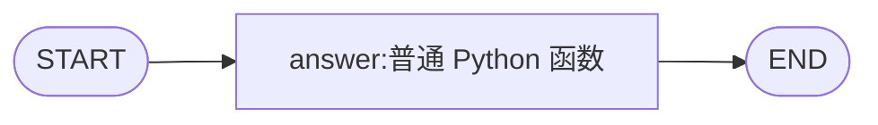

# 第 01 课：状态、节点与边

> 备课状态：可学习。2026-10-21 已完成离线示例与关键行为验证；练习骨架保留待补全部分。学习者尚未验收。

## 本课目标与场景

企业知识问答助手收到问题后，需要把问题传到处理步骤，并把处理结果写回状态。本课先用普通 Python 函数返回“收到问题：……”，观察数据如何流动。这是固定工作流，还没有检索、模型回答或由模型决定下一步的 Agent。

本课只有一个核心目标：**解释并验证节点只返回 `answer` 时，最终状态为什么仍保留 `question`。** 学完应能读懂最小图、预测结果，并独立补全一个返回部分更新的节点。

条件分支、循环、列表累积、真实模型与状态持久化留到后续课程。之前的“最多检索三次”思考题仍待作答，本课不视为已掌握。

## 前置知识与运行条件

- Python：能读懂字典取值、函数参数、`return` 和格式化字符串；不熟悉时先读下一节的普通 Python 对照。
- 本项目实查版本：Python **3.12.13**、LangChain **1.4.6**、LangGraph **1.2.16**（2026-10-21）。LangChain 本课不直接调用。
- `langgraph` 已在 `pyproject.toml` 和 `uv.lock` 中声明，无需新增依赖；首次在本项目安装环境用 `uv sync --locked`。
- 本课离线运行，不加载 `.env`，不需要模型凭据，也不发送模型请求。

## 文件位置与运行命令

| 类型 | 路径 |
| --- | --- |
| 讲义 | [01_state_node_edge.md](01_state_node_edge.md) |
| 导师示例 | [examples/01_state_node_edge/demo.py](../../examples/01_state_node_edge/demo.py) |
| 学习者练习 | [exercises/01_state_node_edge/exercise.py](../../exercises/01_state_node_edge/exercise.py) |

所有命令从项目根目录 `D:\project\langgraph` 的 PowerShell 执行：

```powershell
uv run python examples/01_state_node_edge/demo.py
uv run python exercises/01_state_node_edge/exercise.py
```

练习是待补全的骨架，首次运行会提示 `NotImplementedError`，具体任务见“动手练习”。参考解答在需要或讲评时再创建。

## 从普通 Python 开始

先看不依赖框架的写法：

```python
def answer_question(state: dict[str, str]) -> dict[str, str]:
    return {"answer": f"收到问题：{state['question']}"}


initial_state = {"question": "什么是 State？", "answer": ""}
update = answer_question(initial_state)
final_state = {**initial_state, **update}
print(final_state)
```

`state['question']` 从字典读取问题；`f"…{…}"` 把问题插入字符串。函数返回的是 `{"answer": "收到问题：什么是 State？"}`，它只包含更新。

`{**initial_state, **update}` 新建一个字典，先放原字段，再用更新覆盖同名字段。**普通函数返回字典不会自动合并**，上面的最后两行显式完成了调用和合并。在本课的 LangGraph 图中，图执行器负责调用节点并按字段应用更新。

这里只类比没有自定义合并规则的串行状态更新，不代表 LangGraph 所有场景都等于字典展开。只有一步字符串处理时，普通 Python 就够用；本课引入图是为后续的多步骤与分支建立共同写法，不保证提高回答质量或速度。

## 核心概念与执行过程

| 概念 | 本课对应内容 | 作用 |
| --- | --- | --- |
| 状态（State） | 包含 `question`、`answer` 的字典 | 保存各步骤需要读写的数据 |
| 节点（Node） | `answer_question` 函数，注册名为 `answer` | 读取当前状态，返回字段更新 |
| 边（Edge） | `START → answer → END` | 指定执行关系 |



`START` 和 `END` 是框架的入口、结束标记，不需要自己编写对应函数。节点注册名 `"answer"` 与状态字段 `"answer"` 在本例恰好相同，二者承担不同用途：前者用于连边，后者存放结果。

输入：`{"question": "什么是 State？", "answer": ""}`。

| 时点 | `question` | `answer` | 谁在工作 |
| --- | --- | --- | --- |
| 调用前 | `什么是 State？` | 空字符串 | 程序提供初始状态 |
| 节点读入 | `什么是 State？` | 空字符串 | 普通 Python 函数读取状态 |
| 节点返回更新 | 未返回此字段 | `收到问题：什么是 State？` | 函数返回一个字典 |
| 图应用更新后 | `什么是 State？` | `收到问题：什么是 State？` | 图保留未更新字段，覆盖 `answer` |
| 到达 `END` | `什么是 State？` | `收到问题：什么是 State？` | 本次执行结束 |

**节点返回值是更新，`graph.invoke(...)` 的返回值才是本课这张图执行后的最终状态。** 返回值不包含 `question` 并不等于要求删除它。

## 本课 API 怎样用

标准库导入 `from typing import TypedDict`，框架导入 `from langgraph.graph import END, START, StateGraph`。以下为本课用法，不是接口的全部签名；已核对安装版本的签名。

| API | 来源 | 调用、关键参数与默认行为 | 返回对象或可观察结果 |
| --- | --- | --- | --- |
| `TypedDict` | 标准库 `typing` | `class State(TypedDict): ...`，声明字段名与类型 | 状态结构描述；实际传入的值仍是普通字典，本身不提供运行时字段校验 |
| `StateGraph` | `langgraph.graph` | `builder = StateGraph(State)`，`State` 是状态结构；本课不设置独立输入、输出结构 | 图构建器，尚未执行节点 |
| `add_node` | `builder` 的方法 | `builder.add_node("answer", answer_question)`，显式给出注册名和函数对象；不要写 `answer_question()` | 返回构建器自身；注册函数，并不在此时调用 |
| `add_edge` | `builder` 的方法 | `builder.add_edge(START, "answer")` 等，参数是起点、终点 | 返回构建器自身；本课静态边确定下一步，不执行业务逻辑 |
| `START`、`END` | `langgraph.graph` | 分别作为入口边起点、结束边终点 | 特殊标记，不是状态字段，也不是可调用函数 |
| `compile` | `builder` 的方法 | `graph = builder.compile()`；本课保持 `checkpointer=None` 的默认设置 | 可执行图 `CompiledStateGraph`；检查图结构，不会执行节点或证明业务正确 |
| `invoke` | 编译后 `graph` 的方法 | `graph.invoke(initial_state)`；本课使用默认 `stream_mode="values"`、`version="v1"`，不设输出过滤 | 本例返回最终状态字典；用 `result["question"]`、`result["answer"]` 读取字段 |

节点本身也是普通函数：`answer_question(state: State) -> dict[str, str]`。输入是当前状态，输出只声明本次变化。本课没有自定义归并器（reducer），同一字段的后续更新采用覆盖规则；第 02 课再对比累积规则。

API 说明依据 [官方 Graph API](https://docs.langchain.com/oss/python/langgraph/graph-api)，本课取舍与输出再由本地 1.2.16 版本验证。官方网页会更新；学习时优先对照本课记录的实际版本。

## 最小示例讲解

完整脚本见 [导师示例](../../examples/01_state_node_edge/demo.py)，核心代码如下。运行前先预测：节点返回的字典和最后打印的字典分别包含哪些字段？

```python
from typing import TypedDict

from langgraph.graph import END, START, StateGraph


class State(TypedDict):
    question: str
    answer: str


def answer_question(state: State) -> dict[str, str]:
    print("节点读到：", state)
    update = {"answer": f"收到问题：{state['question']}"}
    print("节点返回：", update)
    return update


builder = StateGraph(State)
builder.add_node("answer", answer_question)
builder.add_edge(START, "answer")
builder.add_edge("answer", END)
graph = builder.compile()


def main() -> None:
    initial_state: State = {"question": "什么是 State？", "answer": ""}
    print("初始状态：", initial_state)
    result = graph.invoke(initial_state)
    print("最终状态：", result)


if __name__ == "__main__":
    main()
```

`class State(TypedDict)` 描述字典字段，不是创建一份会自动填充的状态。我们显式提供两个字段的初始值。

`builder` 定义结构，`graph` 执行结构。脚本先注册函数和连边，再编译，只有走到 `graph.invoke` 时才会打印节点读入和返回内容。`if __name__ == "__main__"` 让脚本直接运行时调用 `main()`。

代码没有改写 `state["answer"]`，而是返回更新。不要依靠原地修改共享字典表达图状态变化，这会让数据流难以检查。

## 预期输出与实测结果

固定输入的预期输出如下；2026-10-21 实际运行后，输出与此一致：

```text
初始状态： {'question': '什么是 State？', 'answer': ''}
节点读到： {'question': '什么是 State？', 'answer': ''}
节点返回： {'answer': '收到问题：什么是 State？'}
最终状态： {'question': '什么是 State？', 'answer': '收到问题：什么是 State？'}
```

导师实际执行：

```powershell
uv run python examples/01_state_node_edge/demo.py
uv run python exercises/01_state_node_edge/exercise.py
```

示例退出码为 `0`。未补全的练习退出码为 `1`，定位到 `measure_question`，提示 `NotImplementedError: 请补全 measure_question，返回 question_length 的更新。`，这是骨架的预期行为。

另外通过 PowerShell 向 `uv run python -` 传入一次性校验代码，直接调用示例中的真实图并检查以下行为；校验退出码为 `0`，输出六项 `PASS`。没有新增测试依赖或参考解答，也没有替学习者补全练习。

| 校验项 | 实测结果 |
| --- | --- |
| 建图与 `compile()` | 未触发节点打印，节点尚未执行 |
| 正常问题、`State` 配旧答案、空字符串配旧答案 | 三种输入均保留原问题，答案被新值覆盖；空问题的答案为 `收到问题：` |
| 单独调用节点 | 返回值只包含 `answer`，而非完整状态 |
| 缺少 `question` 的输入 | 抛出 `KeyError: 'question'`，没有静默补值 |
| 临时构造返回字符串的节点 | 抛出 `InvalidUpdateError`，不能将纯文本当成字段更新 |
| 原始练习骨架 | 能编译图，在 `measure` 节点抛出预留的 `NotImplementedError` |

本次工具捕获输出时，Python 标准输出编码为 `gbk`，中文显示乱码。改用当前终端的 UTF-8 输出后重新运行，得到上面的可读输出；代码文件保持 UTF-8。处理方式见“常见问题”。

## 效果怎么样

- 功能：已验证最终状态保留原问题，`answer` 由节点更新，执行在 `END` 结束；旧答案会被覆盖。
- 质量：这只是固定字符串拼接，不是知识问答质量测试，也不能证明模型能力提升。
- 性能与成本：本课不调用模型；模型 token 和模型请求费用不适用。本地执行耗时、内存尚未测量。
- 边界：本课没有配置检查点保存器（checkpointer），不演示跨调用记忆或重启恢复；`TypedDict` 不会自动补齐缺少的字段；函数异常应保留诊断信息。

## 动手练习

编辑 [练习文件](../../exercises/01_state_node_edge/exercise.py)，任务是给同一条工作流加一个“统计问题长度”的步骤。

练习骨架已准备好三个字段 `question: str`、`answer: str`、`question_length: int`，以及 `START → answer → measure → END` 的连线。你只需要补全 `measure_question` 的函数体。

要求：

1. 先用一句话描述思路：节点读什么，返回哪些字段，哪些旧字段应该留下。
2. 用 `len(state["question"])` 统计字符数，**只返回 `question_length` 的更新**；不修改输入字典，不返回完整状态。
3. 运行练习，核对原问题、前一节点的答案都保留，初值 `question_length=0` 被正确覆盖。

给定输入 `question="State"`，预期最终状态：

```python
{"question": "State", "answer": "收到问题：State", "question_length": 5}
```

这里只统计 Python 字符串的长度，不是模型 token 数，也不等于屏幕上所有复杂字符的显示宽度。

如果卡住，依次看提示：

- 节点的返回结构可模仿示例中的 `update`，只需一个键。
- 读取来源是 `question`，不是上一个节点生成的 `answer`。

## 验收方式

- 能解释 State、Node、Edge 在代码中分别对应什么，以及 `compile()` 和 `invoke()` 的区别。
- 能用“节点返回更新 → 图按字段应用更新”解释为什么 `question` 没有丢失。
- 独立补全长度节点，运行给定输入得到上面的结果；再把问题换成空字符串，长度应为 `0`，且 `answer` 应为 `收到问题：`。
- 能说明少传 `question` 时，`TypedDict` 不会自动生成它，节点读取时会报错。

导师验证示例只能证明示例行为，练习骨架创建或启动也不能证明学习者已经通过验收。

## 常见问题与排查

`KeyError`、`InvalidUpdateError`、练习占位异常和捕获输出乱码均已在本次验证中观察到；缺少依赖的情形本次未遇到，列作环境排查参考。

| 现象 | 原因与检查方式 | 修复方式 |
| --- | --- | --- |
| `ModuleNotFoundError: No module named 'langgraph'` | 可能用了项目环境外的 Python；检查是否从根目录通过 `uv run` 执行 | 从根目录执行 `uv sync --locked`，再用本课命令运行 |
| 节点读取 `question` 时发生 `KeyError` | 初始状态缺少该键；检查输入字典，类型声明不会填入默认值 | 显式传入 `question`；本课不擅自将缺失问题转成成功结果 |
| 节点返回字符串后出现 `InvalidUpdateError` | 本课普通状态节点需要返回字段更新字典 | 返回 `{"answer": "内容"}`；不要只返回字符串 |
| 练习抛出 `NotImplementedError` | 骨架主动提示尚未作答；定位到 `measure_question` | 用你自己的字段更新替换该占位语句 |
| 工具捕获的中文输出乱码 | 本次查询到 `sys.stdout.encoding` 为 `gbk`，与捕获端的文本编码不一致 | 在当前 PowerShell 设置 `$env:PYTHONIOENCODING = "utf-8"` 后重新运行；此设置只影响当前终端的后续 Python 进程 |

## 下一步与官方资料

下一课拟比较默认覆盖与归并器（reducer）的累积行为，解释为什么同一个列表字段有时会保留历史、有时只剩最后一次更新。根据本课作答再准备第 02 课；本次尚无学习者验收证据，不记录为已掌握。

- [图、编译与状态](https://docs.langchain.com/oss/python/langgraph/graph-api#graphs)
- [节点](https://docs.langchain.com/oss/python/langgraph/graph-api#nodes)
- [边](https://docs.langchain.com/oss/python/langgraph/graph-api#edges)
- [默认字段更新规则](https://docs.langchain.com/oss/python/langgraph/graph-api#default-reducer)

### 本次备课检查

- [x] 先写讲义，确定输入、预期输出、API 与单一练习。
- [x] 创建导师示例与练习骨架。
- [x] 实际运行，验证部分更新、覆盖和失败行为。
- [x] 回填实测，更新课程索引与学习入口。
