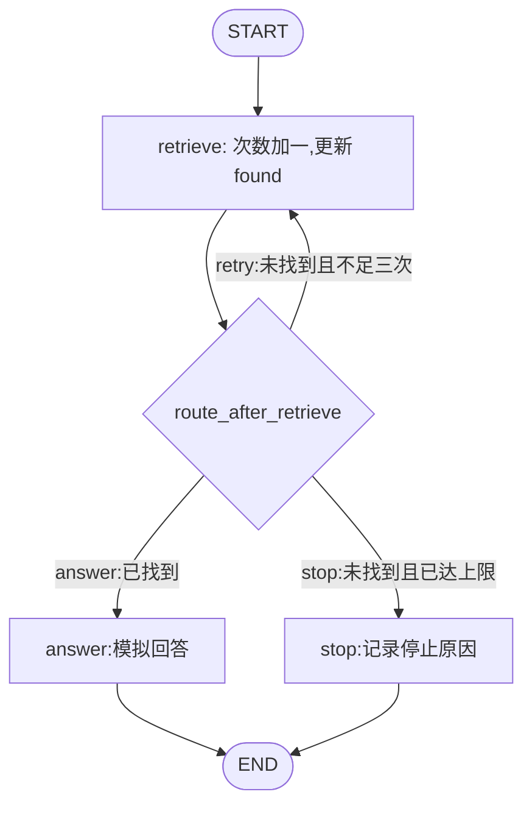

# 第 03 课：条件路由与有限循环

> 备课状态：可学习。2026-10-22 已运行离线示例，六项关键行为测试通过；练习保留路由占位。学习者尚未回答“最多检索三次”的思考题。

## 本课目标与场景

前两课的图按固定顺序执行。本课让知识问答助手根据检索结果选择：找到资料就回答，没找到就再查，最多检索三次后停止。

核心目标：**让循环有明确的业务退出条件，并能解释一次路由判断读到的状态。** “最多三次”包含第一次检索，即首次尝试加最多两次重试。

所有检索均为模拟，使用 `find_on_attempt` 控制在第几次找到资料：`1`、`2`、`3` 分别表示对应次数命中，`0` 表示始终未找到。没有访问知识库、模型或外部工具，也没有由模型自主决策。

## 前置条件与运行方式

- 已完成前两课的部分更新与列表累积练习；继续使用普通 Python 函数和 `Annotated[list[str], add]`。
- 本次实查：Python 3.12.13、LangChain 1.4.6、LangGraph 1.2.16（2026-10-22）。无新增依赖；首次装环境仍用 `uv sync --locked`。
- 不加载 `.env`，不需要模型凭据。测试使用 Python 标准库 `unittest`，不安装测试框架。

| 内容 | 路径 |
| --- | --- |
| 讲义 | [03_routing_loops.md](03_routing_loops.md) |
| 完整示例 | [examples/03_routing_loops/demo.py](../../examples/03_routing_loops/demo.py) |
| 学习者练习 | [exercises/03_routing_loops/exercise.py](../../exercises/03_routing_loops/exercise.py) |
| 关键行为测试 | [tests/test_03_routing_loops.py](../../tests/test_03_routing_loops.py) |

从项目根目录 `D:\project\langgraph` 的 PowerShell 执行：

```powershell
uv run python examples/03_routing_loops/demo.py
uv run python exercises/03_routing_loops/exercise.py
uv run python -m unittest discover -s tests -p "test_*.py" -v
```

当前自动化测试加载导师示例，检查其业务路由和终止行为。测试通过不能代替对学习者练习的查验；练习须自行运行四种模拟条件并解释结果。

## 先理解数据与执行顺序

本课状态字段：

| 字段 | 初值 | 更新规则与用途 |
| --- | --- | --- |
| `question: str` | `什么是条件路由？` | 保留原问题 |
| `find_on_attempt: int` | 由案例指定 | 模拟条件，不是真实检索参数；本课只传非负整数 |
| `attempts: int` | `0` | 每次检索返回旧值加一，用默认规则覆盖 |
| `found: bool` | `False` | 每次检索返回本次是否命中 |
| `attempts_log: Annotated[list[str], add]` | `[]` | 每次只返回一条记录，由图累积 |
| `answer: str` | `""` | 回答或停止节点写入明确结果 |

普通 Python 也可用 `while`、`if` 和计数器完成这个任务。LangGraph 在这里负责组织步骤、应用状态更新和按条件调度；框架不会代替我们设计退出条件。



图中的菱形代表条件边使用的路由函数，不需要把它注册为业务节点。

一次检索的顺序是：

1. `retrieve` 读当前次数，计算 `attempts + 1`。
2. 节点返回次数、是否命中以及一条日志。
3. 图先应用这些更新。
4. `route_after_retrieve` 读取**更新后的**次数与命中结果，返回分支标签。
5. 图按映射执行回答、再次检索或停止节点。

以第二次命中为例：

| 时点 | `attempts` | `found` | 后续行为 |
| --- | --- | --- | --- |
| 初始 | 0 | False | 进入检索 |
| 第一次检索完成 | 1 | False | 返回 `retry` |
| 第二次检索完成 | 2 | True | 返回 `answer` |
| 回答节点完成 | 2 | True | 到达 `END` |

## 本课 API 怎样用

沿用 `from langgraph.graph import END, START, StateGraph`。新接口是构建器的 `add_conditional_edges`：

```python
builder.add_conditional_edges(
    "retrieve",                  # 哪个节点完成后判断
    route_after_retrieve,        # 传函数对象，不加括号调用
    {"answer": "answer", "retry": "retrieve", "stop": "stop"},
)
```

| API 或对象 | 输入、关键参数与默认行为 | 返回与观察点 |
| --- | --- | --- |
| `builder.add_conditional_edges` | `source` 为来源节点名，`path` 为路由函数，第三参数 `path_map` 显式映射标签到目标节点 | 返回构建器；路由返回 `retry` 时执行 `retrieve`，无需注册名为 `retry` 的节点 |
| `route_after_retrieve` | 本课自定义普通函数，输入当前 `State`；返回类型标为 `Literal["answer", "retry", "stop"]` | 返回字符串标签，不返回更新字典；`Literal` 从标准库 `typing` 导入，只是取值范围的类型提示 |
| `graph.invoke` | 初始状态由 `make_initial_state(...)` 构造；本课入口始终从 `attempts=0` 开始 | 返回最终状态，检查次数、命中结果、日志和最终答复 |
| `graph.stream` | 同样接收初始状态；本课显式使用 `stream_mode="updates"` 或 `"values"`，以及 `version="v1"` | 返回迭代器，循环时执行图；`updates` 展示各节点的部分更新，`values` 展示完整状态快照 |
| `config={"recursion_limit": 20}` | 调用图时的配置，不是状态字段；限制图执行的超步（super-step）数量 | 是编排层兜底，超限会报 `GraphRecursionError`；不等于业务上的“三次检索” |
| `END` | 回答、停止节点各用一条静态边连到 `END` | 正常结束本次运行；未命中到上限属于预期业务结果，不作为程序异常 |

本课使用已核对的 1.2.16 签名。官方流式页面的新例子多使用 `version="v2"`，其输出包在 `type`、`ns`、`data` 中；本课明确选 `v1` 直接观察更新字典或状态字典，避免混用输出格式。官方也介绍较新的事件流接口，本课先使用常用 `stream` 方法观察状态。

## 最小例子的关键部分

路由的规则按顺序表达为：

```python
def route_after_retrieve(state: State) -> Literal["answer", "retry", "stop"]:
    if state["found"]:
        return "answer"
    if state["attempts"] >= MAX_ATTEMPTS:
        return "stop"
    return "retry"
```

`MAX_ATTEMPTS = 3`。先判断成功，再判断未成功时是否用完次数：如果第三次恰好找到资料，仍然应该进入回答。

检索节点每次计算 `attempt = state["attempts"] + 1`，返回新的 `attempts`。它只返回一条 `attempts_log`，不带回旧日志，复用上一课的增量合并规则。

检索节点返回类型中的 `int | bool | list[str]` 表示这个字典不同字段的值可能是整数、布尔值或字符串列表；`|` 在类型表达式中表示“或”，同样不会自动校验实际值。

`attempts` 使用默认覆盖，不能再随意配置为求和归并器，否则节点返回的“新总次数”又被求和，计数可能跳成 `1 → 3`。需要先明确字段更新代表“总量”还是“增量”。

## 预期输出与实测结果

示例执行以下四个案例，2026-10-22 实测与预期一致：

| `find_on_attempt` | 预期实际检索次数 | 预期结果 |
| --- | --- | --- |
| 1 | 1 | 第一次命中，模拟回答 |
| 2 | 2 | 第一次重试后命中，模拟回答 |
| 3 | 3 | 第三次命中，仍然模拟回答 |
| 0 | 3 | 三次均未命中，明确停止 |

实际运行：

```powershell
uv run python examples/03_routing_loops/demo.py
uv run python -m unittest discover -s tests -p "test_*.py" -v
uv run python exercises/03_routing_loops/exercise.py
```

示例退出码 `0`；测试输出 `Ran 6 tests`、`OK`，退出码 `0`。未补全的练习退出码 `1`，在路由函数抛出预留的 `NotImplementedError: 请补全 route_after_retrieve，返回分支标签。`，不算作学习者已完成。

测试覆盖：

| 检查 | 实测 |
| --- | --- |
| 第 1、2、3 次命中 | 命中后及时回答，日志条数等于实际次数，原问题保留 |
| 始终不命中，或计划第 4 次才命中 | 都只执行 3 次检索，记录停止原因，没有第 4 条检索日志 |
| 路由边界 | 未命中且次数为 1 时重试，为 3 或更大时停止；第 3 次命中时回答 |
| 检索节点的更新 | 次数加一，只返回一条新日志，不原地改写旧日志 |
| `updates`，第 2 次命中 | 依次输出 `retrieve`、`retrieve`、`answer` 三条节点更新；每次检索只带一条日志，无未更新的 `question` |
| `values`，第 2 次命中 | 输出初始状态和三次节点执行后的快照，共 4 条；最终累计两条检索日志和模拟答复 |

实际未命中结果片段：

```python
{
    "attempts": 3,
    "found": False,
    "attempts_log": ["第1次：未找到", "第2次：未找到", "第3次：未找到"],
    "answer": "停止：已检索3次，仍未找到资料。",
}
```

该片段省略了保留的 `question`、`find_on_attempt`，完整输出可运行示例查看。

`updates` 的第一条实测为：

```python
{"retrieve": {"attempts": 1, "found": False, "attempts_log": ["第1次：未找到"]}}
```

这里不会包含未更新的 `question`；而 `values` 会包含初始状态以及每步更新后的完整状态。示例分别调用两个流式模式，**会重新执行两次图**，并非读取同一次执行的历史记录。

本课没有模型，因此这里的流是图状态变化，和模型逐 token 输出不同。

## 效果与限制

- 功能：已确认最多三次检索、命中及时退出、未命中明确停止；第 3 次命中边界与日志累积均通过检查。
- 质量：固定模拟条件只用于验证执行流程，不证明真实检索质量或 Agent 自主决策能力。
- 成本：本地耗时、内存未测；模型请求、模型 token 和费用不适用。真实检索场景每次循环可能产生额外外部请求，需另行测量。
- 本课只演示正常命中和检索为空，不演示网络错误、工具异常或模型失败。真实异常不能伪装成“未找到”。
- 本课每次从全新状态运行，不配置持久化，也不支持从任意中间计数恢复；恢复主题后续再讲。
- `TypedDict`、`Literal` 不自动完成运行时校验。分支标签必须匹配映射，拼错可能导致运行时报错。

## 一道核心练习

[练习文件](../../exercises/03_routing_loops/exercise.py) 已提供状态、模拟检索、回答、停止节点和完整连线；只留 `route_after_retrieve` 待补全，首次运行实测会主动提示 `NotImplementedError`。

任务：实现路由，使 `1`、`2`、`3`、`0` 四种模拟条件符合上表。先说明需要读取哪两个字段、检查顺序是什么，再写代码。保留检索节点、计数和日志规则，不用修改框架步数上限代替业务退出。

核心思考：第三次检索恰好命中时，应该返回什么？如果把“次数达到上限”放到“已找到”前面，业务行为会怎样变化？这是同一道路由练习的边界检查。

## 验收标准

- 能区分节点返回字段更新和路由返回分支标签，说明映射的左右两侧分别是什么。
- 独立补全路由，四种条件下均正确结束；失败日志恰好三条，没有第四次尝试。
- 能解释路由为什么能看到刚增加的次数，以及第三次命中为何应回答。
- 能通过 `updates` 找到每次节点执行，通过 `values` 找到累计状态；不将其称为模型 token 流。
- 能指出业务次数上限与图步数上限的区别。

导师代码验证与学习者独立作答分开记录；本课尚未验收。

## 常见问题与排查

练习占位异常和两种流式输出已实测；其余是基于业务逻辑和接口约定的排查指引，本次未逐项注入错误复现。

| 现象 | 原因与检查点 | 修正方向 |
| --- | --- | --- |
| 一直重复检索，最后报图步数超限 | 路由一直返回重试，或检索没有返回新次数 | 核对次数更新以及未命中时的上限条件，不只调大 `recursion_limit` |
| 第三次命中却停止 | 先按次数停止，未先检查是否找到 | 按业务优先级区分成功和用尽次数的未命中 |
| 返回 `retry` 却找不到后续路径 | 标签和 `path_map` 不一致 | 核对键为返回标签、值为实际节点名 |
| 同时执行回答和重试 | 既给 `retrieve` 连了无条件后继，又配置条件边 | 本例从 `retrieve` 离开只由条件边决定 |
| 看不到 `question` | 使用了 `updates`，本次节点没有更新问题 | 改用 `values` 观察完整状态 |
| 练习出现 `NotImplementedError` | 路由仍是占位实现 | 在练习文件中补全函数，不修改 `.venv` 内部代码 |

## 下一步与官方资料

本次围绕条件退出完成练习；下一课再准备消息角色与模板，随后才接入真实模型。尚未配置模型适配包或验证模型服务。

- [LangGraph 条件边](https://docs.langchain.com/oss/python/langgraph/graph-api#conditional-edges)
- [LangGraph 图执行步数限制](https://docs.langchain.com/oss/python/langgraph/graph-api#recursion-limit)
- [流式模式与 v1/v2 输出格式](https://docs.langchain.com/oss/python/langgraph/streaming)

若工具捕获中文输出乱码，可先在当前 PowerShell 设置 `$env:PYTHONIOENCODING = "utf-8"` 后重跑；本次工具验证使用此设置。

### 备课检查

- [x] 先写目标、状态变化、API、边界与练习。
- [x] 创建示例、练习与关键行为测试。
- [x] 运行分支和终止测试，核对流式输出。
- [x] 回填实测，更新课程入口与学习记录。
